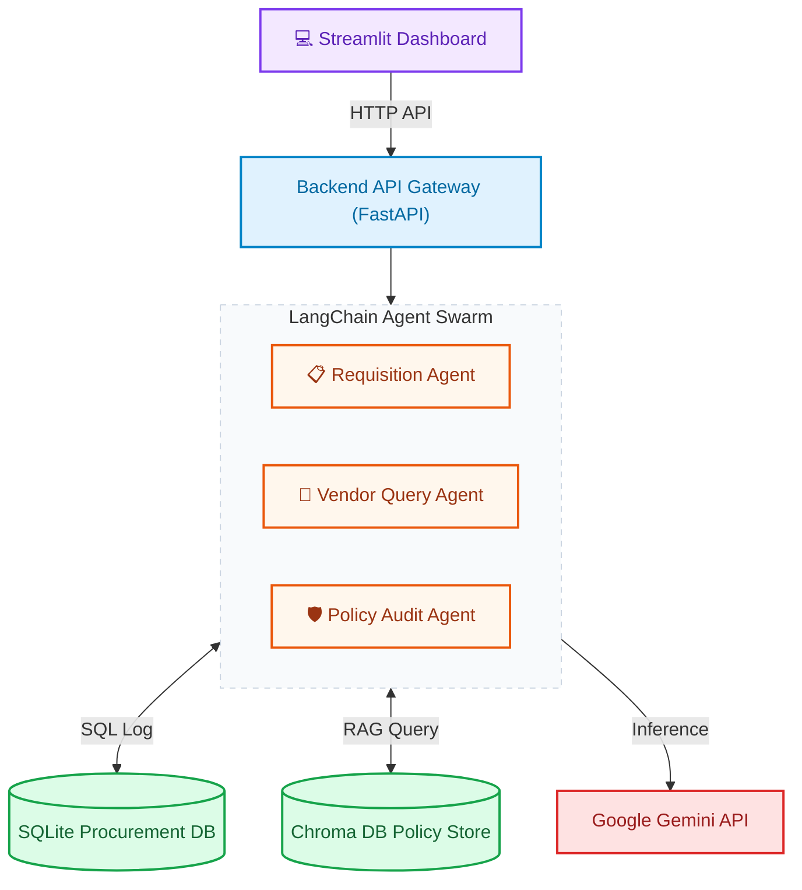

# 🛒 Enterprise Procurement Agent

<p align="center">
  
  
  
  
  
  
  
</p>

An intelligent, multi-agent procurement workspace driven by Streamlit, FastAPI, LangChain, and Google's Gemini models. This workspace coordinates purchasing compliance audits, vendor query resolutions, and automated purchase order generations. It leverages an SQLite database for structured tracking and Chroma DB for vector search/RAG indexing of corporate policy guides.

---

## 🎨 System Architecture



---

## ✨ Key Features

*   **Multi-Agent Coordination**: Employs LangChain custom agents specialized in Requisition Routing, Vendor Query Resolution, and Compliance Audit checks.
*   **Structured Logging**: SQLite transaction management for tracking purchase order stages, requisition updates, and vendor communication details.
*   **Corporate Policy RAG**: Vector similarity search using Chroma DB over ingested PDF procurement manuals, ensuring all requisitions comply with standard corporate budget guidelines.
*   **Model Context Protocol (MCP)**: Dynamic tool integration exposed through FastAPI endpoints to query live models.
*   **Interactive Streamlit Panel**: Easy-to-use client interface for tracking agent execution logs, viewing policy search hits, and creating orders.

---

## 🛠 Tech Stack

-   **Frontend**: Streamlit
-   **Backend Gateway**: FastAPI · Uvicorn
-   **Agent Framework**: LangChain
-   **Structured DB**: SQLite (SQLAlchemy connection)
-   **Vector Index**: Chroma DB (Retrieval-Augmented Generation)
-   **LLM Provider**: Google Gemini API

---

## 🚀 Getting Started

### 1. Setup Virtual Environment
```bash
python -m venv venv
# On Windows PowerShell:
.\venv\Scripts\Activate.ps1
# On Linux/macOS:
source venv/bin/activate
```

### 2. Install Dependencies
```bash
pip install -r requirements.txt
```

### 3. Configure Environment
Copy `.env.example` to `.env`:
```bash
cp .env.example .env
```
Fill in your `GEMINI_API_KEY` (Get one free at [Google AI Studio](https://aistudio.google.com/)).

### 4. Initialize Databases
Initialize SQLite schema and Chroma DB vector indexes:
```bash
python setup_db.py
python setup_vector_db.py
```

### 5. Running the Application

#### Start the FastAPI Server
```bash
python main.py
```
FastAPI backend and MCP server start at `http://localhost:8080`.

#### Start the Streamlit Client
In a new terminal (with virtual environment active):
```bash
streamlit run streamlit_app.py
```

---

## 📂 Project Structure

*   `streamlit_app.py`: Streamlit control panel interface.
*   `main.py`: FastAPI server configuration hosting backend API.
*   `agents.py`: LangChain multi-agent definition and tools mapping.
*   `mcp_server.py`: Model Context Protocol tool implementation.
*   `setup_db.py`: Database table generation and mockup values ingestion.
*   `setup_vector_db.py`: Ingests PDF manuals into Chroma DB vector embeddings.

---

## 🏁 License & Contact

Distributed under the MIT License. See `LICENSE` for more information.

*Project Lead: Akmal Khan*  
*Email: akmal.shahbaz@iub.edu.pk*  
*Repository Link: [https://github.com/akmalkhaniub/enterprise-procurement-agent](https://github.com/akmalkhaniub/enterprise-procurement-agent)*
